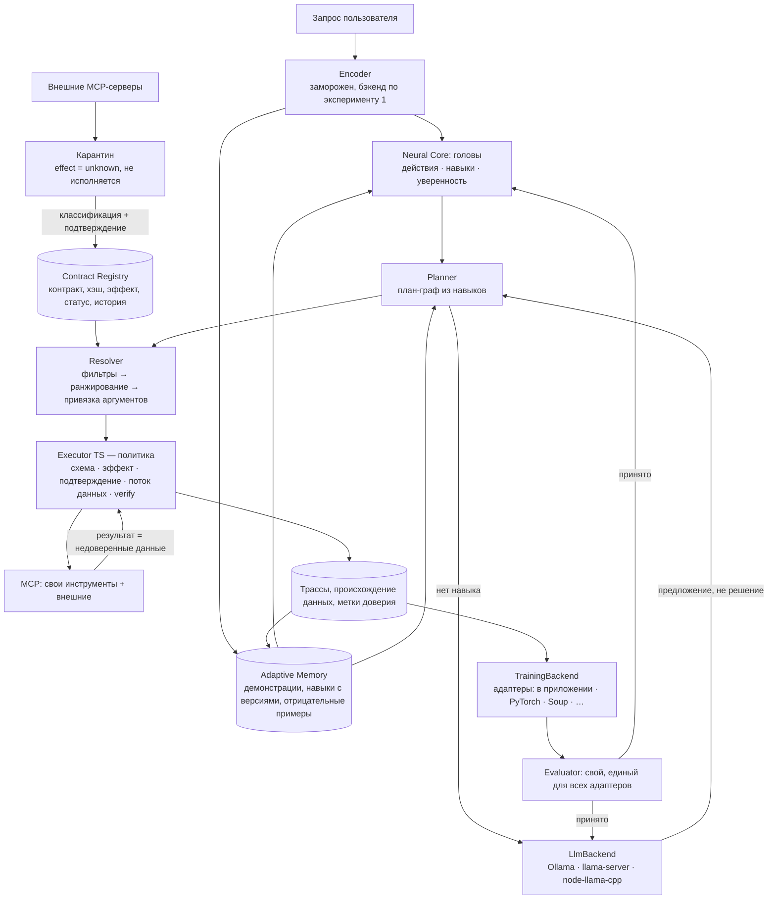

# План: локальный обучаемый маршрутизатор действий (Neural Router)

Живой документ. Отмечать `[x]` по мере выполнения, решения фиксировать в «Журнале решений».
Исходная постановка — запрос «Исследование и проектирование локальной обучаемой Neural Router» (10.11.2026). Ниже — разбор того, что из неё выполнимо, и план, по которому идём. Ревизия 2 (10.11.2026) уточняет локальную LLM, безопасность неизвестных инструментов, Resolver, выделение навыков, защиту от prompt injection, метрики, интерфейс обучения и размещение компонентов по процессам.

**Код по плану не пишется, пока не закрыт этап 0** (раздел 12).

У каждого утверждения указано основание:
- **[код]** — проверено в исходниках (нашего проекта или библиотеки);
- **[реестр]** — версия и лицензия взяты из npm или Hugging Face 10.11.2026;
- **[документация]** — взято из документации или спецификации, на нашей сборке не проверялось;
- **[оценка]** — инженерная оценка, не замер;
- **[гипотеза]** — проектное решение, которое держится, пока его не опроверг эксперимент; полный список — в разделе 11.1;
- **[литература]** — известные результаты исследований.

Ни одна цифра задержки, памяти или качества в этом документе **не измерена**. Все они — оценки или пороги, которые проверяют эксперименты.

## 1. Итог анализа

**Коротко.** Требование «своя маленькая нейросеть понимает запрос, строит план, заполняет аргументы по JSON Schema и переносит навыки на незнакомые инструменты, без LLM, в 500 МБ» в таком виде **невыполнимо**. Выполнима **гибридная** схема, в которой каждая часть делает то, что ей по силам:

- **Предобученный энкодер (заморожен)** понимает смысл запроса и описаний инструментов, в том числе незнакомых.
- **Свои маленькие обучаемые головы** — настоящая собственная нейросеть. Они определяют абстрактные действия, оценивают уверенность и участвуют в ранжировании инструментов как одно из ранжирующих свойств. Обучаются локально **[оценка: секунды или минуты на CPU]**.
- **Эпизодическая память демонстраций** даёт быстрое обучение без изменения весов.
- **Локальная LLM через подключаемый бэкенд** собирает недостающие шаги и аргументы, когда готового навыка нет. Размер модели **не зафиксирован**: выбирает эксперимент 3. Грамматика гарантирует только форму ответа, но не смысл.
- **Детерминированный исполнитель на TypeScript** — единственное место, где действует политика:
  - проверка аргументов по схеме;
  - карантин неизвестных инструментов;
  - подтверждения;
  - проверка результата.

  Ни модель, ни данные политику изменить не могут.

**Почему нельзя обойтись своей сетью без языковой модели.**
- Заполнить аргументы произвольной схемы из фразы («сравни с предыдущей задачей» → какой ключ у предыдущей?) — это генерация структурированного текста. Она требует широкой языковой предобученности, а у нас будут сотни демонстраций, а не миллиарды токенов.
- Модели, обученные с нуля на малых данных, систематически проваливают композиционное обобщение: новые сочетания известных операций. Это показано на бенчмарках SCAN и COGS **[литература]**. Сочетание предобученной модели со структурой (план в виде графа, ограниченный выбор) работает заметно лучше.
- Значит, «настоящая обучаемая сеть» реальна для **распознавания и выбора** (действия, навыки, уверенность, ранжирование). Для **сборки нового** нужна предобученная генеративная модель. Её тоже можно дообучать, и это тоже «своя» сеть.

| Требование постановки | Выполнимо? | Как |
|---|---|---|
| Работа без облака | Да | Всё локально: энкодер и LLM через локальные бэкенды (раздел 7) |
| Понимание запроса на естественном языке | Да | Многоязычный энкодер + головы |
| Абстрактные действия, а не «фраза → имя функции» | Да | Головы предсказывают действия; инструмент выбирает Resolver по контракту и данным плана (раздел 5) |
| Новый MCP без переобучения | Частично | Сопоставление по описанию, схеме, типам и истории. Новый инструмент **не исполняется**, пока его эффект не классифицирован и не подтверждён (раздел 5.1) |
| Композиция навыков в новые сценарии | Частично, **[гипотеза]** | План-граф из навыков; новые сочетания собирает LLM в рамках грамматики. Качество меряет эксперимент C |
| Быстрое обучение на демонстрациях | Да | Память примеров + навыки с жизненным циклом (раздел 6.1), без изменения весов |
| Глубокое обучение весов | Да | Через независимый интерфейс `TrainingBackend` (раздел 6.5); головы — в приложении, LoRA — внешними адаптерами |
| Inference ≤ 500 МБ ОЗУ | Только лёгкий контур, **[гипотеза]** | Энкодер + головы + память **[оценка: 200–300 МБ]**. LLM — отдельный процесс по требованию, его память учитывается отдельно |
| Без обязательного Python | Да | Inference полностью без Python. Python — только в необязательных адаптерах обучения |

**Что пока гипотеза.** Всё, что касается качества (энкодер, головы, перенос навыков, композиция, точность аргументов у малой LLM), ресурсов (ОЗУ, задержки) и работы нативных модулей в упакованном приложении. Полный список с экспериментами и запасными решениями — в разделе 11.1.

## 2. Что уже есть в Qvarch и на что опираемся

| Что | Где | Значение для роутера |
|---|---|---|
| Инструменты с уровнями доступа `read` / `doc` / `write` / `run` | `src/main/mcp.ts` (`McpTool`), `shared/agent/turn.ts` (`TOOL_ACCESS`) **[код]** | Разделение чтения и изменений уже есть |
| Реестр провайдеров агентов и исполнителей по протоколам | `shared/agent/providers.ts`, `main/agent/agentRunner.ts` (`RUNNERS`) **[код]** | Роутер — новый протокол `local`, без переделки чатов и harness |
| Ollama как провайдер (OpenAI-совместимый, `localhost:11434/v1`) | `AGENT_PROVIDERS.ollama` **[код]** | Готовая основа для **эксперимента 0** и первый бэкенд LLM |
| Траектория хода и учёт токенов | `shared/agent/trajectory.ts`, `shared/agent/usage.ts` **[код]** | Основа для «Inspect». Для обучения не хватит: текст режется до 240 символов (`TRAJ_TEXT_MAX`) |
| Harness: план, критерии приёмки, проверки блоками | `shared/agent/harness/` **[код]** | Источник **меток доверия**: «проверка прошла» ≠ «вызов вернул 200» |
| Процессы-исполнители в `utilityProcess` | `main/process/processSupervisor.ts` **[код]** | Лимит задаётся флагом `--max-old-space-size`, а он ограничивает **только кучу V8** **[документация]**. Память ONNX Runtime и llama.cpp им не ограничена: нужен контроль по RSS (раздел 8) |
| Отдельный бинарник ML-движка + модели по требованию | `main/voice.ts`: `whisper-cli.exe` через `child_process`, модели в `data/models` с проверкой SHA-256 **[код]** | Готовый образец для `llama-server` (раздел 7.2) |
| Нативный модуль в сборке | `@lydell/node-pty`, `asarUnpack` в `electron-builder.yml` **[код]** | Образец упаковки N-API-модулей |
| SQLite (`node:sqlite`) | `main/db.ts` **[код]** | Память примеров, реестр контрактов, векторы — без отдельной БД |
| **MCP-клиента нет** | Qvarch — только MCP-сервер **[код]** | Подключать чужие MCP-серверы пока нельзя. Это **этап 1** |
| **`ajv` нет в зависимостях** | `package.json` **[код]** | Добавляется на этапе 4 (раздел 7.3) |

## 3. Архитектура



### Ответственность компонентов

| Компонент | Отвечает за | Не отвечает за | Где работает (раздел 7.2) |
|---|---|---|---|
| Encoder | Векторы запроса, описаний инструментов, шагов плана | Решения | `utilityProcess` «ml» |
| Neural Core (головы) | Какие абстрактные действия нужны; какой известный навык подходит; уверенность; «выполнить / уточнить / ничего не вызывать»; предложение эффекта нового инструмента | Аргументы, окончательный выбор инструмента, политика | `utilityProcess` «ml» |
| Adaptive Memory | Демонстрации, исправления, навыки (версии, прототипы, отрицательные примеры) | Хранение «сценарий целиком = ответ» | SQLite в main; поиск — в «ml» |
| Contract Registry | Контракты MCP: схема, хэш контракта, эффект, тип объекта, статус (карантин / предложен / подтверждён), история вызовов | Выбор под задачу | main |
| Resolver | Фильтры совместимости, ранжирование, привязка аргументов, альтернативы, объяснение | Порядок шагов, политика | main, TS |
| Planner | План-граф, подстановка навыков, запрос к LLM за недостающим | Выполнение | main, TS |
| LlmBackend | Генерация недостающих шагов и аргументов по грамматике | Политика, выбор вне списка | отдельный процесс (раздел 7.2) |
| Executor | **Вся политика**: `ajv`, эффект и карантин, подтверждения, контроль потока данных, `verify`, повтор | Решение, что делать | main, TS |
| TrainingBackend + Evaluator | Обучение через адаптеры; единая оценка и приёмка версий | Работа в реальном времени | фон / внешний процесс |

## 4. Abstract Action Space

Исходный набор из 11 операций смешивает три разные вещи, поэтому разделяем их на три оси **[оценка]**.

**1. Эффект вызова инструмента.** Его даёт реестр, а не сеть.

| Эффект | Было в постановке | Смысл | Исполняется? |
|---|---|---|---|
| `unknown` | — | Эффект не установлен | **Нет**: инструмент в карантине (раздел 5.1) |
| `find` | DISCOVER | Найти объекты по условию (список, поиск) | После подтверждения эффекта |
| `read` | RETRIEVE, INSPECT | Получить объект или его часть по ссылке | После подтверждения эффекта |
| `create` | CREATE | Создать | После подтверждения эффекта + на каждый вызов, пока не разрешено иначе |
| `update` | MODIFY | Изменить | так же |
| `delete` | DELETE | Удалить | так же |
| `run` | EXECUTE | Запустить процесс, тест, запрос с побочными эффектами | так же |

**2. Операции над данными внутри плана.** Инструменты для них не вызываются: `compare`, `compose` (собрать текст или структуру из результатов), `extract` (взять поле или ссылку из результата), `summarize`. Их выполняет Planner: детерминированно, если хватает, иначе через LLM.

**3. Управление.** `verify` (условие на результат), `wait` (условие + таймаут), `ask_user` (уточнение или подтверждение), `no_tool` (ответить без вызова).

**Объект** — отдельное поле, а не часть действия: тип и ссылка (`issue`, `note`, `page`, `request`, `unknown`). Для неизвестного типа берётся название из схемы инструмента, а вектор — из описания. Соответствие типов разных серверов (например, «задача» у двух трекеров) хранится в таблице синонимов. Её пополняет пользователь, головы только предлагают.

**Иерархия.** Навык — именованный подграф (`compare_with_previous`, `run_and_report`) с параметрами и версией. Он может входить в другие планы. Как навык появляется и меняется — раздел 6.1.

### Формат плана (граф, ветвления, параллельность)

```json
{
  "goal": "Сравнить задачу KEY-123 с предыдущей и оставить комментарий",
  "nodes": [
    { "id": "a", "op": "read",    "object": { "type": "issue", "ref": "KEY-123" } },
    { "id": "b", "op": "find",    "object": { "type": "issue" }, "where": { "before": "$a.key", "sameProject": "$a.project" }, "take": 1 },
    { "id": "c", "op": "compare", "inputs": ["$a", "$b"] },
    { "id": "d", "op": "create",  "object": { "type": "comment", "parent": "$a" }, "body": "$c.text", "confirm": true },
    { "id": "e", "op": "verify",  "check": "$d.ok && $d.id" }
  ],
  "edges": [["a","b"], ["a","c"], ["b","c"], ["c","d"], ["d","e"]]
}
```

- Узлы без общих зависимостей выполняются параллельно.
- Условие — узел `verify` с ветками `then` / `else` (подграфы).
- Циклы запрещены. Повтор — это узел `wait` или `retry` с ограничением.
- Ссылки `$x.field` — единственный путь, которым результат одного шага попадает в другой. Свободный текст результатов не превращается в новые шаги (раздел 9.2).

## 5. Contract Registry и Resolver

**Что хранится по каждому инструменту:**
- сервер, имя, описание, `inputSchema`, выход (если сервер его описывает);
- **хэш контракта** (имя + описание + схемы): если он меняется, инструмент возвращается в карантин;
- **эффект** (включая `unknown`) и **тип объекта**;
- **статус:** `quarantined` → `proposed` (эффект предложен автоматически) → `confirmed` (подтверждён пользователем);
- подсказки MCP (`readOnlyHint`, `destructiveHint`, `idempotentHint`, `openWorldHint`) — как сведения, не как доказательство;
- вектор описания;
- уровень доступа и разрешения пользователя (например, «чтение с этого сервера — без подтверждения»);
- история вызовов: успехи, ошибки схемы, исправления, отмены.

### 5.1. Неизвестные инструменты: карантин

Правила **[решение, не гипотеза]**:
1. Новый инструмент получает `effect: unknown` и статус `quarantined`.
   - В карантине он **не исполняется** ни в каком режиме, включая сухой прогон с вызовом.
   - В план он может попасть только как кандидат, который показывается пользователю.
2. Классификация **предлагает** эффект. Она ничего не разрешает. Признаки для предложения:
   - голова «эффект по контракту»;
   - правила по схеме: обязательный `id` и поля текста, глагол в имени;
   - подсказки MCP.

   Итог — статус `proposed` с уверенностью и объяснением.
3. **Исполнение возможно только после `confirmed`.** Пользователь видит предложенный эффект, описание, схему и подсказки сервера и подтверждает или исправляет. Подтвердить можно сразу весь сервер, но показываются все инструменты.
4. **Аннотации MCP не доказывают безопасность.** Спецификация MCP прямо требует считать их недоверенными, если сервер не доверенный **[документация]**. Поэтому `readOnlyHint: true` — лишь признак для классификации. Он не снимает карантин и не отменяет подтверждения.
5. При расхождении сильнее всего то, что опаснее:
   - эффект «изменяет» по любому источнику — подтверждение на каждый вызов, пока пользователь не разрешит явно;
   - «чтение» признаётся только по подтверждению пользователя.
6. Хэш контракта сменился (сервер обновился или подменил описание) → снова `quarantined`. Пользователю показывается, что изменилось.
7. Инструмент без осмысленного описания и схемы (`x_do(a, b)`) остаётся `unknown`, пока пользователь сам не укажет эффект.

### 5.2. Алгоритм Resolver

Сходство векторов — **одно из свойств ранжирования, а не критерий выбора**. Порядок работы для каждого шага плана:

**Шаг 1. Жёсткие фильтры.** Кандидат отбрасывается, если не выполнено хотя бы одно условие:
- статус `confirmed` (карантин и `proposed` — только в списке «можно подключить»);
- эффект совпадает с эффектом шага. «Пониже» не подставляется: шагу `read` нельзя дать инструмент `update`, и наоборот;
- тип объекта совместим: совпадает, есть в таблице синонимов или у шага `unknown`;
- политика доступа разрешает инструмент в этом ходе;
- **обязательные поля выполнимы**: каждое `required` из `inputSchema` можно заполнить из одного из источников шага 2 или спросить у пользователя.

**Шаг 2. Привязка аргументов.** Для каждого поля схемы ищутся источники, по убыванию надёжности:
1. явное значение в шаге плана;
2. ссылка на результат предыдущего шага (`$a.key`) с совместимым типом;
3. значение из запроса пользователя (сущность, извлечённая энкодером или LLM);
4. значение по умолчанию из схемы;
5. LLM — только для полей, которые не закрыты пунктами 1–4;
6. `ask_user`.

Каждое значение проверяется на совместимость с полем: тип, `enum`, `format`, `pattern`. Подстановка из другого сервера отмечается для контроля потока данных (раздел 9.2).

**Шаг 3. Ранжирование** оставшихся кандидатов по свойствам:

| Свойство | Что меряет |
|---|---|
| Покрытие аргументов | Доля обязательных и желательных полей, закрытых источниками 1–4 (без LLM и без вопроса) |
| Качество привязки | Совпадение типов, имён и описаний полей с источником |
| Согласованность с планом | Инструмент того же сервера, что выдал входные данные (ключ из трекера → инструмент трекера), или явно совместимый по типам |
| История | Успехи и исправления для этой пары «действие + тип объекта» и для этого навыка; недавние отмены пользователя — штраф |
| Сходство описаний | Косинус «шаг ↔ описание инструмента» (энкодер) |
| Стоимость | Средняя задержка, побочные эффекты, необходимость подтверждения |

- **Сначала** веса задаются вручную и сочетаются линейно.
- **Потом** их заменяет обучаемая голова-ранжировщик: попарное обучение на выборах из трасс. Она принимается, только если обходит ручные веса в эксперименте B.

**Шаг 4. Решение:**
- на выходе 1–3 кандидата с калиброванной уверенностью и разложением по свойствам — это и есть объяснение для Inspect;
- уверенность ниже порога, лидер близок ко второму месту или есть незакрытые обязательные поля — `ask_user` с альтернативами;
- кандидатов нет — `ask_user` («нужен инструмент, который …») или `no_tool`. Подмены эффекта не бывает.

**Предел «нового MCP без обучения».** Сопоставление работает, если у инструмента осмысленное описание и схема. Иначе — раздел 5.1, пункт 7.

## 6. Обучение

### 6.1. Fast Learning — сразу, без изменения весов

**Демонстрация** = запрос + план-граф + привязки к инструментам + аргументы с источниками + результат + оценка + происхождение данных. Её источники:
- удачный ход, записанный кнопкой;
- исправление пользователя;
- ход, прошедший проверку harness.

**Влияние сразу:**
- k ближайших примеров добавляются к голосам голов (kNN-слой поверх голов). Отрицательные примеры вычитаются;
- те же примеры идут в подсказку LLM как образцы;
- прототип навыка пересчитывается мгновенно.

**Исправление** сохраняется как пара «было → стало» с весом выше обычного примера. Отвергнутый план становится отрицательным примером для ближайших запросов.

#### Жизненный цикл навыка

Не каждый подграф становится навыком. Цикл такой:

1. **Нормализация.** Демонстрация переводится в абстрактные операции. Литералы, пришедшие из запроса или из результатов, заменяются **слотами** с типом (`issue.key`, `text`), а константы остаются константами. Две демонстрации с разными ключами дают одну и ту же нормализованную форму.
2. **Кандидаты.** Подграф становится кандидатом, только если выполнено всё сразу:
   - он связан потоком данных (ссылками), а не просто стоит рядом;
   - в нём 2–6 узлов;
   - у него есть вход-слот и проверяемый выход (`verify` или результат, который дальше используется);
   - он не совпадает с уже существующим навыком.

   Отдельный вызов одного инструмента навыком не считается: это уже знает Resolver.
3. **Подтверждение** (`candidate` → `confirmed`), одним из путей:
   - пользователь в Teach даёт имя, проверяет параметры и пример;
   - тот же нормализованный подграф встретился в ≥ 3 независимых доверенных демонстрациях с разными значениями слотов и прошёл тест переноса. Тогда Lab **предлагает** навык, но без подтверждения пользователя он не включается.

   Навыки с изменяющими эффектами подтверждает только пользователь.
4. **Объединение.** Два навыка с одинаковой структурой (изоморфные графы операций с совместимыми типами слотов) и близкими прототипами — предложение объединить. Различающиеся константы становятся параметрами.
5. **Разделение.** Если использования навыка распадаются на группы (запросы кластеризуются на 2+ группы, исправления бьют в одну ветку) или часто используется только его префикс, Lab предлагает разделить или выделить поднавык.
6. **Версии.** У навыка есть:
   - `id`, `version`, хэш структуры;
   - слоты, прототипы;
   - исходные демонстрации, отрицательные примеры;
   - метрики переноса.

   Любое изменение даёт новую версию. Старые хранятся, откат одной кнопкой. Трасса помнит, какая версия навыка работала.
7. **Отрицательные примеры.** С навыком хранятся запросы, на которых он был выбран ошибочно, и отвергнутые планы. Порог выбора навыка учитывает разницу «сходство с положительными − сходство с отрицательными», а не только сходство.
8. **Тест переноса** — перед подтверждением и для каждой новой версии. Это сухой прогон без вызовов, план сравнивается с эталоном на четырёх наборах:
   - перефразировки запроса (написанные пользователем или сгенерированные LLM с пометкой «синтетика»);
   - другие значения слотов;
   - другие объекты того же типа;
   - другой сервер с тем же эффектом, если он есть.

   Порог — эксперимент A.
9. **Забывание.** Неиспользуемые кандидаты удаляются через срок. Подтверждённые навыки не удаляются автоматически, только помечаются как «давно не использовался».

### 6.2. Deep Learning — пакетами, в фоне

**Что обучаем:**
- **Головы** (MLP над замороженным энкодером): действия, навыки, эффект по контракту, уверенность, ранжировщик Resolver. Обучение на CPU **[оценка: секунды или минуты на тысячах примеров]**. Первый адаптер — в приложении (раздел 6.5), эксперимент 6.
- **Энкодер** — не трогаем, а если трогаем, только контрастно на парах «запрос — навык» и «шаг — описание инструмента», и только после эксперимента: риск сломать общее понимание.
- **LLM-планировщик** — LoRA на проверенных трассах, внешним адаптером. По желанию, когда накопятся сотни **проверенных** трасс.

**Порядок обучения:**
- **Данные:** только примеры с меткой доверия выше порога (раздел 9.3).
- **Разбиение:** train / val / test по запросам. Отдельный **замороженный набор регрессии** из исправлений пользователя и ключевых сценариев.
- **Против забывания:**
  - буфер повторов: старые примеры в каждой партии;
  - сравнение с прошлой версией на наборе регрессии.
- **Приёмка новой версии** — своим Evaluator, а не метриками адаптера. Подробно — раздел 11.2.
- **Версии:** у каждой модели есть контрольная точка, метрики, данные, адаптер и дата. Откат одной кнопкой.
- **Когда запускать:** не после каждого запроса. По накоплению N новых проверенных примеров, по кнопке или ночью.

### 6.3. Contract Learning

- Новый MCP осваивается без изменения весов: вектор описания, предложение эффекта, Resolver. Исполнение — только после подтверждения (раздел 5.1).
- Голову «эффект по контракту» дообучают пакетно на подтверждённых пользователем контрактах.

### 6.4. Источник данных: учитель

Самый быстрый путь к сотням трасс — ходы уже работающего облачного агента. Claude Code в Qvarch вызывает те же инструменты, и их трассы — готовые демонстрации.
- **Нужно:** хранить полные трассы, а не только 240 символов.
- **Риск:** условия использования облачного провайдера могут ограничивать обучение моделей на его ответах. **Проверить до запуска.** Альтернатива — только демонстрации и исправления пользователя.

### 6.5. TrainingBackend — независимый интерфейс обучения

Архитектура не привязана ни к одному инструменту обучения. Ядро знает только этот контракт (набросок, не код к исполнению):

```ts
/** What a training run produces and consumes — independent of the tool that trains. */
type TrainingKind = 'heads' | 'ranker' | 'encoder-contrastive' | 'planner-lora'
type ArtifactFormat = 'heads-json' | 'onnx' | 'gguf' | 'lora-safetensors'

interface TrainingJob {
  kind: TrainingKind
  dataset: { path: string; schemaVersion: number } // our own JSONL export, see below
  base?: { model: string; sha256: string }         // for encoder / planner kinds
  params: Record<string, number | string>          // epochs, lr, rank… — validated by the adapter
}

interface TrainingBackend {
  readonly id: string                                  // 'in-app', 'pytorch-scripts', 'soup', 'manual'
  capabilities(): { kinds: TrainingKind[]; needsPython: boolean; needsGpu: boolean; formats: ArtifactFormat[] }
  check(): Promise<{ ready: boolean; problem?: string }> // env present, versions ok
  start(job: TrainingJob, onProgress: (p: { stage: string; ratio: number }) => void): Promise<{ artifact: string; format: ArtifactFormat; log: string }>
  cancel(): void
}
```

- **Набор данных** экспортируется в **свой** формат: JSONL с номером версии схемы. Адаптер сам переводит его в формат своего инструмента (чат-шаблон для SFT, пары для контрастного обучения). Формат Soup, `trl` или чего-то ещё в ядро не проникает.
- **Оценка** — всегда свой Evaluator на своих наборах (val, регрессия, тест переноса). Метрики, которые печатает адаптер, только информируют. Так адаптеры сравнимы между собой.
- **Артефакт** регистрируется в реестре версий моделей: формат, SHA-256, адаптер, набор данных, метрики. Загрузчик выбирается по формату, а не по адаптеру.
- **Адаптеры:**

| Адаптер | Что умеет | Когда |
|---|---|---|
| `in-app` | `heads`, `ranker` на TS, в `utilityProcess`; формат `heads-json` | Этап 6, по умолчанию |
| `pytorch-scripts` | Свой короткий PyTorch Trainer в `scripts/ml/`: `heads`, `encoder-contrastive`, `planner-lora` (`peft`); экспорт ONNX / GGUF | Этап 7, если эксперимент 6 или 5 покажет нужду |
| `soup` | `planner-lora`, экспорт GGUF, через CLI `soup-cli` | Этап 7, только если выиграет у `pytorch-scripts` в эксперименте 5 |
| `manual` | Выгрузить набор данных, загрузить готовый артефакт (обучение на чужой машине с GPU) | Всегда как запасной путь |

- Python-адаптеры работают внешним процессом с отдельным окружением. Приложение не ставит Python и не зависит от него.

## 7. Технологии

### 7.1. Выбор и основания

| Задача | Выбор | Основание | Альтернативы |
|---|---|---|---|
| Энкодер, модель | `intfloat/multilingual-e5-small`: 117,6 млн параметров, MIT, есть ONNX, в том числе qint8 | **[реестр]**; достаточность — **[гипотеза]**, эксперимент 1 | `paraphrase-multilingual-MiniLM-L12-v2` (117,6 млн, Apache-2.0) |
| Энкодер, бэкенд | Решает эксперимент 1 по качеству × размеру × сложности упаковки:<br/>(а) `onnxruntime-node` 1.31.1 (MIT) + токенизатор;<br/>(б) `@huggingface/transformers` 4.3.2 (Apache-2.0) — проще, но тянет больше;<br/>(в) эмбеддинги через тот же бэкенд, что и LLM (`llama-server --embedding` или Ollama) — без нативного модуля в Electron | **[реестр]**; работа в упакованном Electron — **[гипотеза]** | Python-процесс — нарушает требование «без Python» |
| Головы | Свой MLP в TS | Маленькие: проще своё, чем зависимость | ONNX — если эксперимент 6 покажет, что TS медленнее порога |
| Векторный поиск | Перебор в TS по `Float32Array` из SQLite | До ~10 тыс. векторов × 384 **[оценка: миллисекунды]** | `hnswlib-node` 3.0.0, `sqlite-vec` 0.1.9 — только при замеренной нехватке |
| Хранилище | `node:sqlite` (уже в проекте) | **[код]** | — |
| LLM, бэкенд | Интерфейс `LlmBackend` + адаптеры (раздел 7.2, таблица ниже) | — | — |
| LLM, модель | **Не зафиксирована.** Кандидаты (раздел 7.4):<br/>`Qwen2.5-0.5B-Instruct` (494 млн);<br/>`Qwen3-0.6B` (752 млн);<br/>`Qwen2.5-1.5B-Instruct` (1,54 млрд), все Apache-2.0 | **[реестр]**; выбор — эксперимент 3 | Модели 3–4 млрд — как верхняя граница качества в эксперименте, лицензию каждой проверить отдельно |
| Проверка аргументов | `ajv` 8.20.0 (MIT) | **[реестр]**; в проекте его нет **[код]** | Своя проверка подмножества JSON Schema — только если `ajv` окажется тяжёлым |
| MCP-клиент | `@modelcontextprotocol/sdk` 1.32.2 (MIT) | **[реестр]** | Свой клиент — дублирование |
| Обучение | `TrainingBackend` + адаптеры (раздел 6.5) | — | — |

**Бэкенды LLM.** Ядро вызывает только интерфейс `LlmBackend`: `generate(prompt, jsonSchema | grammar, limits) → { json, tokens, ms }`, плюс `load`, `unload` и `health`.

| Адаптер | Как работает | Ограниченная генерация | За | Против | Роль |
|---|---|---|---|---|---|
| **Ollama** | Внешний сервис пользователя, HTTP; провайдер уже есть **[код]** | Параметр `format` с JSON Schema **[документация — проверить на нашей версии]** | Ноль зависимостей в приложении; пользователь сам управляет моделями | Нужна установка Ollama; память вне нашего контроля | Эксперимент 0 и первый адаптер |
| **llama-server** (llama.cpp) | Наш бинарник отдельным процессом ОС, как `whisper-cli` **[код — образец]**; OpenAI-совместимый HTTP на localhost | GBNF и JSON Schema **[документация]** | Полная изоляция: процесс можно убить, память не в Electron; нет нативного модуля в Electron; заодно эмбеддинги | Свой бинарник в сборке (+ размер), обновление вручную | Кандидат во встроенный бэкенд |
| **node-llama-cpp** 3.22.3 | N-API-модуль в `utilityProcess` | JSON Schema → грамматика **[документация]** | Готовый API, грамматика из схемы, загрузка моделей | Нативный модуль под ABI Electron; крупные готовые бинарники; память не ограничена `--max-old-space-size` | Кандидат во встроенный бэкенд |
| **OpenAI-совместимый** (LM Studio, vLLM и т. п.) | HTTP к тому, что пользователь уже запустил | Зависит от сервера | Бесплатно по коду: тот же адаптер, что для llama-server | Возможности разные | Для опытных пользователей |
| ONNX Runtime GenAI, transformers.js | В процессе | — | — | Привязок для Node нет или они не стабильны **[не проверено]**; генерация моделей 1,5 млрд на CPU в JS **[оценка: медленно]** | Не берём, пока не будет замера в их пользу |

Выбор встроенного бэкенда (llama-server или node-llama-cpp) делает эксперимент 3 по качеству (одинаковому при одной модели), холодному старту, памяти, размеру сборки и сложности упаковки. Ollama остаётся адаптером в любом случае.

### 7.2. Что работает внутри Electron, а что — отдельным процессом

| Компонент | Где | Почему |
|---|---|---|
| Registry, Resolver, Planner, Executor | Main-процесс, TS | Миллисекунды, без нативного кода; Executor должен сидеть рядом с IPC и подтверждениями |
| Хранилище | Main, `node:sqlite` | Уже так **[код]** |
| Энкодер + головы + векторный поиск | Один `utilityProcess` «ml» через `ProcessSupervisor` | Тяжёлые вычисления не блокируют main. При бэкенде (в) из раздела 7.1 этот процесс остаётся чистым TS |
| Обучение голов (`in-app`) | Тот же «ml» или отдельный `utilityProcess` на время обучения | Чистый TS, без зависимостей |
| LLM | Отдельный процесс ОС (llama-server) или `utilityProcess` (node-llama-cpp) — по эксперименту 3; Ollama — чужой процесс | Сотни МБ – ГБ памяти, все ядра; нужна возможность убить без вреда для приложения |
| LoRA и прочие Python-адаптеры | Внешний процесс с отдельным окружением | Не часть приложения |

**Контроль памяти.** `--max-old-space-size` не ограничивает нативную память **[документация]**. Поэтому для процессов с моделями `ProcessSupervisor` дополняется сторожем по RSS: `app.getAppMetrics()` для `utilityProcess`, размер процесса для бинарника. Превышение порога ведёт к выгрузке модели, затем к перезапуску. Это правка существующего механизма, а не новый.

### 7.3. Правило зависимостей

Тяжёлая или нативная зависимость добавляется только при выполнении всех условий:
- эксперимент показал, что без неё не достигается порог;
- замерен прирост размера сборки;
- проверена упаковка в portable-сборку (`asarUnpack`, как у `node-pty`);
- лицензия совместима.

| Зависимость | Когда добавляется | Тяжёлая? |
|---|---|---|
| `@modelcontextprotocol/sdk` | Этап 1 | Нет (чистый JS) |
| `ajv` | Этап 4 | Нет (чистый JS) |
| Бэкенд энкодера (`onnxruntime-node` или `@huggingface/transformers`) | Этап 2, **только** если эксперимент 1 выберет вариант (а) или (б) | Да, нативный |
| `node-llama-cpp` **или** бинарник `llama-server` | Этап 5, по эксперименту 3 | Да |
| `hnswlib-node`, `sqlite-vec` | Не планируются | — |
| Python, `torch`, Soup | Никогда в приложении — только внешние адаптеры обучения | — |

### 7.4. Выбор модели планировщика

Модель 0,5 млрд **не считается достаточной заранее**. JSON-грамматика гарантирует, что ответ разбирается и соответствует схеме по форме. Но правильность ключа, выбор поля, ссылка на нужный шаг и сама структура плана она **не гарантирует** **[решение]**. Поэтому:
- 0,5B, 0,6B, 1,5B (и верхняя граница 3–4B) сравниваются **на одинаковых задачах** в эксперименте 3 по одинаковому протоколу (раздел 11.2), на одинаковой квантизации (Q4_K_M) и одном бэкенде; затем лучшие — на втором бэкенде;
- категории задач:
  1. аргументы для знакомых инструментов;
  2. аргументы для **незнакомых MCP-контрактов** (тестовый сервер эксперимента B);
  3. ссылки на результаты прошлых шагов;
  4. многошаговые планы из 2–5 узлов с ветвлением;
  5. случаи `no_tool` / `ask_user`, где правильно — ничего не вызывать;
- каждая задача гоняется с грамматикой и без неё. Так видно, сколько ошибок грамматика убирает и сколько смысловых ошибок остаётся;
- смысловые ошибки ловит не модель, а детерминированные проверки:
  - `ajv` (`enum`, `format`, `pattern`);
  - проверка ссылок `$x.field` на существование и тип;
  - сверка значений со значениями из запроса и результатов;
  - `verify` после вызова;
  - подтверждение изменяющих шагов.

  Эксперимент 3 меряет, сколько ошибок доходит до подтверждения;
- правило выбора: самая маленькая модель, которая укладывается в допуск от лучшей по сквозному успеху (раздел 11.2) и не даёт ни одного опасного вызова мимо подтверждения. Модель — настройка пользователя с этой рекомендацией по умолчанию.

### 7.5. Soup — роль и вывод

Изучен по исходникам: клон репозитория 10.11.2026, версия `soup-cli` 0.77.2 **[код]**.
- **Что это:** CLI на Python для дообучения LLM. Лицензия Apache-2.0, статус Alpha, Python 3.11–3.13.
- **Внутри:** обёртка над `transformers` (≥ 5.16.1), `peft`, `trl`, `torch` (≥ 2.6), плюс ветка MLX для Mac.
- **Есть:**
  - тренеры SFT, DPO, KTO, ORPO, GRPO, PPO, distill;
  - `classifier` (поверх `AutoModelForSequenceClassification`);
  - `embedding` (контрастное и triplet-обучение);
  - шаблон синтетических данных для вызова инструментов и команда `soup agent` (данные для tool-calling SFT, обучение, оценка);
  - экспорт в GGUF и ONNX;
  - ветки кода для CPU.
- **Подходит** для одного места: **LoRA-SFT планировщика на трассах и экспорт в GGUF**. Для этого он удобен, но это та же связка `transformers` + `peft` + `trl`.
- **Не нужен** для голов и памяти: они маленькие, обучаются в TS или PyTorch за минуты, Soup там только добавит тяжёлых зависимостей.
- **Риски:**
  - статус Alpha и очень быстрые релизы (уже 77 минорных версий, последний коммит — в день проверки);
  - тяжёлые зависимости (`torch`);
  - жёсткие рамки версий Python.
- **Решение:** Soup — один из адаптеров `TrainingBackend` (раздел 6.5), не зависимость и не часть архитектуры. Базовый путь — `pytorch-scripts`. Soup сравнивается с ним в эксперименте 5.

## 8. Ресурсы

Все числа — **[оценка]**, их заменяют замеры эксперимента E. Ни одно не измерено.

| Компонент | Диск | ОЗУ после загрузки | Задержка на запрос | CPU |
|---|---|---|---|---|
| Энкодер e5-small qint8 | ~120 МБ | ~150–250 МБ | ~10–40 мс на короткий текст | 1 ядро на мгновение |
| Головы | < 5 МБ | < 20 МБ | < 1 мс | — |
| Memory + Registry (10 тыс. записей) | ~20–50 МБ (SQLite) | ~20–40 МБ | ~2–10 мс поиск | — |
| Planner + Resolver + Executor (TS) | — | ~10–30 МБ | < 5 мс без LLM | — |
| **Лёгкий контур, итого** | ~150 МБ | **~200–300 МБ** | **~50 мс** | — |
| LLM 0,5–0,6 млрд Q4 (по требованию) | ~0,4–0,5 ГБ | ~0,5–0,8 ГБ | план ~150 токенов: ~3–10 с | все ядра на время генерации |
| LLM 1,5 млрд Q4 (по требованию) | ~1 ГБ | ~1,2–1,6 ГБ | ~8–25 с | все ядра |

**Как считаем память:** суммарный RSS всех наших процессов роутера (`utilityProcess` + процесс LLM), а не куча V8. Для Ollama — отдельной строкой: это чужой процесс.

**Режимы:**
- лёгкий контур загружается при первом обращении и выгружается после N минут простоя;
- LLM загружается только когда плану не хватает навыков, и выгружается после простоя;
- сторож RSS (раздел 7.2) выгружает или перезапускает процесс при превышении;
- в настройках — «отключить роутер», «отключить LLM-планировщик», выбор бэкенда и модели.

**Обучение на CPU:**
- головы — секунды или минуты **[оценка]**;
- LoRA для 0,5 млрд на CPU — часы на сотни примеров **[оценка]**, поэтому это ночной режим или адаптер `manual` с чужой машиной с GPU. Замер — эксперимент 5.

## 9. Безопасность и доверие

### 9.1. Политика исполнения

- **Политика живёт в коде Executor**, а не в подсказке модели. Ни модель, ни данные не могут её изменить (раздел 9.2).
- **Карантин:** `unknown` и неподтверждённые эффекты не исполняются (раздел 5.1).
- **Проверка аргументов** по схеме (`ajv`) перед каждым вызовом. Невалидные аргументы не исполняются, а возвращаются в Planner.
- **Эффекты `create` / `update` / `delete` / `run`** выполняются только с подтверждением, пока пользователь не разрешит инструмент явно. Подтверждение — в интерфейсе Qvarch, а не в тексте ответа.
- **Порог уверенности** на каждом шаге. Ниже порога — `ask_user` с альтернативами. `no_tool` — законный ответ.
- **Проверка результата:** узел `verify` по смыслу (есть ли созданный id, совпадает ли поле), а не по статусу вызова.

### 9.2. Защита от prompt injection

**Недоверенные источники:**
- описания и схемы MCP-инструментов (отравленное описание);
- результаты вызовов;
- содержимое страниц, заметок, файлов, задач;
- сообщения об ошибках серверов.

Всё это — **данные**, никогда не инструкции.

**Принципы:**
1. **Разделение каналов.** Системные правила и политика — в коде Executor и в системной части подсказки, которую собирает наш код. Недоверенный текст попадает к LLM только внутри размеченного блока данных с указанием источника. Модель обучена и проинструктирована, что инструкции из блока данных не исполняются. Но **защита не держится на этом**: см. пункт 2.
2. **Политика не зависит от выхода модели.** LLM предлагает план. Executor проверяет его по тем же правилам, что и любой план: эффекты, карантин, подтверждения, разрешённые инструменты хода. Текст «вызови `delete` без подтверждения» в результате инструмента может, в худшем случае, повлиять на предложение модели, но не на право его исполнить.
3. **Происхождение значений (taint).** Каждое значение аргумента несёт источник: пользователь, константа навыка, результат инструмента X сервера S. Правила по источнику:
   - значение из недоверенного источника в аргументе изменяющего шага → подтверждение показывает значение и его источник;
   - **поток данных между серверами** (результат сервера A уходит в изменяющий или внешний вызов сервера B, в URL, адрес или тело) → подтверждение всегда, даже если инструмент разрешён. Это главный путь утечки.
4. **План фиксируется до исполнения.** Результаты шагов заполняют только объявленные слоты (`$b.key`). Добавить новый шаг по тексту результата нельзя. Перепланирование посреди хода — новый план, который снова проходит политику целиком, и изменяющие шаги в нём подтверждаются заново.
5. **Описания MCP.**
   - Описание, схема и подсказки фиксируются хэшем при подтверждении. Изменение возвращает инструмент в карантин (раздел 5.1).
   - Описание обрезается по длине и подаётся модели как данные.
   - Признаки подозрительного описания (обращение к другим инструментам, просьбы что-то делать, ссылки, необычная длина) **показываются пользователю при подтверждении**. Это подсказка для человека, а не барьер, и чёрного списка фраз нет.
6. **Защита памяти.** Демонстрация из хода, где в план повлияли недоверенные данные, не становится навыком и не идёт в обучение без явного подтверждения пользователя. Отравленный ход не учит систему.
7. **Секреты** (токены, cookie) не попадают в подсказки LLM, в трассы и в наборы данных: маскируются при записи.

Проверка — эксперимент F (раздел 11.2).

### 9.3. Метки доверия и данные обучения

- **Метка доверия примера** (0–1), из которой берётся вес при обучении:
  - пользователь подтвердил результат — высокая;
  - проверка harness прошла — высокая;
  - пользователь исправил — пример «стало» высокая, «было» — отрицательный;
  - вызов прошёл, но никто не проверял — низкая, в обучение не идёт;
  - сразу после этого пользователь отменил или переделал вручную — отрицательная;
  - на ход влияли недоверенные данные — не выше низкой без подтверждения (раздел 9.2, пункт 6).
- **Ошибочные демонстрации:**
  - новая демонстрация, противоречащая ≥ 2 подтверждённым, помечается «спорная» и ждёт решения в Neural Lab;
  - одна демонстрация не перевешивает накопленный навык (вес по числу подтверждений).
- **Регрессия:** новая версия голов или LoRA не включается, если она хуже на замороженном наборе регрессии сверх допуска (раздел 11.2).
- **Журнал решений** каждого хода хранится полностью (вход, кандидаты, уверенность, свойства ранжирования, выбор, источники значений, результат). Это и «Inspect», и данные для обучения. Секреты в аргументах маскируются.

## 10. Neural Lab

Что реально показывать пользователю (остальное — в отладочный журнал):
- **Inspect:**
  - найденные действия с уверенностью;
  - выбранный навык (с версией) и 2 альтернативы;
  - план-граф;
  - по каждому шагу — выбранный инструмент, 1–2 альтернативы и разложение по свойствам ранжирования;
  - аргументы с источником каждого значения, до и после проверки по схеме;
  - сколько раз и зачем вызывалась LLM;
  - причина уточнения или отказа;
  - результат и проверка.

  Основа — уже существующая траектория хода.
- **Connect:** инструменты в карантине:
  - предложенный эффект и объяснение;
  - подсказки сервера (с пометкой «не доказательство»);
  - признаки подозрительного описания;
  - что изменилось при смене хэша.

  Подтвердить или исправить эффект.
- **Teach:**
  - записать демонстрацию из удачного хода одной кнопкой;
  - поправить план (заменить узел, выбрать другой инструмент);
  - кандидаты в навыки: подтвердить, назвать, объединить, разделить;
  - разобрать спорные примеры.
- **Train:**
  - число проверенных примеров;
  - выбор адаптера `TrainingBackend` и его готовность;
  - метрики новой версии против текущей по протоколу раздела 11.2;
  - включить или откатить.
- **Test:**
  - набор регрессии (запуск, отчёт);
  - тест переноса навыков;
  - «проверить запрос без выполнения» (сухой прогон: план + инструменты, без вызовов).

## 11. Эксперименты до окончательных решений

Порядок важен: эксперимент 0 даёт базовую линию и решает, нужен ли вообще свой слой поверх локальной LLM.

### 11.1. Реестр гипотез

Решения, которые **пока не доказаны**. Пока эксперимент не проведён, они считаются рабочими предположениями.

| № | Гипотеза | Чем проверяется | Если не подтвердилась |
|---|---|---|---|
| H1 | Свой слой (головы + память + Resolver) даёт лучший компромисс качества, скорости и ресурсов, чем локальная LLM со всеми инструментами | 0 против полного контура | Оставить LLM-агент через Ollama + Executor с политикой; головы — только для уверенности и `no_tool` |
| H2 | e5-small достаточно для сопоставления «запрос — действие» и «шаг — инструмент» на русском и английском | 1 | MiniLM, затем энкодер покрупнее (вне бюджета 500 МБ — пересмотр бюджета) |
| H3 | Головы на замороженном энкодере различают действия и калиброваны | 2 | Только kNN по памяти + LLM |
| H4 | Навыки из демонстраций переносятся на перефразировки и другие значения | A | Навыки только по явному вызову пользователем |
| H5 | Resolver с несколькими свойствами точнее, чем одно сходство векторов | B (сравнение с вариантом «только косинус») | Пересмотр свойств и весов |
| H6 | Голова «эффект по контракту» достаточно точна, чтобы **предлагать** эффект | B | Предложение только по правилам схемы; всё равно с подтверждением |
| H7 | Малая модель (≤ 1,5 млрд) с грамматикой даёт смысловую верность аргументов на незнакомых контрактах | 3 | Модель крупнее как опция или облачный провайдер для генерации, локальный — для выбора |
| H8 | Новые сочетания навыков собираются планировщиком | C | Композиция только из подтверждённых шаблонов, иначе `ask_user` |
| H9 | Исправления учитываются сразу и не ломают остальное | D | Повышение веса исправлений, отдельный порог |
| H10 | Лёгкий контур укладывается в ~300 МБ RSS, p95 ≤ 150 мс | E | Меньший энкодер, квантизация, общий процесс с LLM |
| H11 | Нативный бэкенд энкодера и LLM упаковывается в portable-сборку и работает в `utilityProcess` | 1, 3 (сборка) | Бэкенды через отдельный бинарник или Ollama (раздел 7.1, вариант (в)) |
| H12 | Обучение голов на TS ≤ 1 мин на 1 000 примеров с метриками как у PyTorch | 6 | ONNX или адаптер `pytorch-scripts` |
| H13 | LoRA на CPU реалистична ночью | 5 | Только адаптер `manual` (GPU вне приложения) |
| H14 | Защиты раздела 9.2 не пропускают нарушений политики на наборе атак | F | Нарушения политики — дефект, исправляется до выпуска; это не компромисс |

### 11.2. Протокол оценки и метрики

Один протокол для всех экспериментов и для приёмки версий, чтобы цифры были сравнимы.

**Стенд:**
- **Песочница:** тестовые MCP-серверы с состоянием в памяти — трекер, заметки, HTTP-заглушка. На них сквозные задачи выполняются по-настоящему, без вреда для реальных систем, а результат проверяется по итоговому состоянию.
- **Наборы** фиксированы и версионированы:
  - запросы из реальных журналов, обезличенные;
  - синтетические задачи с пометкой «синтетика»;
  - набор атак для эксперимента F.
- **Машина:** типичный ноутбук без GPU, описание железа фиксируется в отчёте.

**Метрики (общий набор):**

| Группа | Метрика |
|---|---|
| Качество | Точность компонента (top-1 / top-3, macro-F1 — где применимо); **сквозной успех**: задача решена, проверено по состоянию песочницы; калибровка уверенности (ECE) |
| Ошибки | Ошибочные вызовы: неверный инструмент, аргументы отклонены `ajv`, вызов прошёл, но смысл неверен. **Опасные вызовы мимо подтверждения**. Лишние `ask_user` (переспрашивание там, где ответ был очевиден) |
| Скорость | Задержка хода p50 / p95, отдельно по стадиям (энкодер, Resolver, LLM, вызовы); холодный и тёплый старт отдельно |
| Ресурсы | Пиковый и средний RSS всех процессов роутера (Ollama — отдельно); CPU-секунды на задачу; диск |
| LLM | Обращений к LLM на задачу; сгенерированных токенов; доля задач, решённых без LLM |

**Как принимаем решения:**
1. **Жёсткие условия** — не компромисс:
   - опасных вызовов мимо подтверждения — 0;
   - нарушений политики в эксперименте F — 0;
   - карантинный инструмент ни разу не исполнен;
   - память в пределах бюджета выбранного режима.
2. **Остальное — компромисс.** Строится фронт Парето по осям «сквозной успех, p95, RSS, обращения к LLM». Безусловного превосходства над базовой линией по всем показателям **не требуется**. Например, свой слой с успехом чуть ниже LLM-агента, но в разы быстрее и почти без обращений к LLM, приемлем.
3. **Допуски** по умолчанию:
   - сквозной успех не ниже лучшего варианта больше чем на 3 п.п.;
   - на наборе регрессии не хуже текущей версии больше чем на 1 п.п.

   Допуски уточняются после эксперимента 0 и записываются в журнал.
4. **Честность цифр:**
   - для качества — доверительные интервалы (bootstrap). Наборы маленькие, разница внутри интервала — не разница;
   - задержки — минимум 3 прогона, медиана прогонов;
   - каждое решение фиксируется в журнале вместе с ценой компромисса.

### 11.3. Эксперименты

Метрики — из общего набора раздела 11.2; ниже — главное для каждого.

| № | Что проверяем | Набор | Главные метрики | Порог / как решаем | Гипотезы |
|---|---|---|---|---|---|
| 0 | Локальная LLM через Ollama со всеми нашими инструментами, без роутера; модели 0,5B, 0,6B, 1,5B | 50 реальных запросов + песочница | Сквозной успех, ошибочные вызовы, p50/p95, RSS, токены | Базовая линия; задаёт допуски для всего остального | H1 |
| 1 | Энкодер: e5-small против MiniLM-L12; варианты бэкенда (а), (б), (в) | 200 пар «запрос — действие» и «шаг — инструмент», русский и английский | top-1 / top-3, задержка, RSS, прирост сборки | top-3 ≥ 0,9 по инструментам; бэкенд — по Парето + упаковке | H2, H11 |
| 2 | Головы действий на замороженном энкодере | Действия размечены на 300 запросах | macro-F1, ECE, доля `no_tool` верно | F1 ≥ 0,85; ECE ≤ 0,1 | H3 |
| **A** | Fast Learning и навыки | 10–20 демонстраций нового навыка; 30 похожих запросов; тест переноса (раздел 6.1, п. 8) | Точность до и после; перенос по 4 наборам; ложные срабатывания навыка на чужих запросах | +30 п.п. на похожих; без потерь на остальных; ложных срабатываний ≤ 5% | H4 |
| **B** | Новый MCP | Тестовый сервер: 10 инструментов с незнакомыми именами и нормальными описаниями + 3 с плохими описаниями + 2 с ложными аннотациями | Верность предложенного эффекта; top-1 Resolver против «только косинус»; исполнений в карантине | Эффект ≥ 0,9 (как предложение); Resolver ≥ 0,8 и не хуже «только косинус»; исполнений в карантине — **0** | H5, H6 |
| 3 | Модели и бэкенды LLM на одинаковых задачах (раздел 7.4) | 100 шагов по 5 категориям; с грамматикой и без | Валидность по схеме; **смысловая** верность значений; верность структуры плана; ошибки, дошедшие до подтверждения; p50/p95; RSS; холодный старт; размер сборки | Выбор по правилу раздела 7.4 | H7, H11 |
| **C** | Композиция | Запросы на новые сочетания изученных навыков; готовых сценариев в обучении нет | Верный план-граф (структура + инструменты); сквозной успех | ≥ 0,7 — иначе пересматриваем роль LLM | H8 |
| **D** | Исправление | 20 исправлений; затем похожие запросы и набор регрессии | Учтено ли исправление; регрессия | Учтено ≥ 0,9; регрессия в допуске | H9 |
| **E** | Ресурсы полного контура | Ноутбук без GPU, 3 прогона | RSS (все процессы), p50/p95 по стадиям, CPU-секунды, холодный старт | Лёгкий контур ≤ 300 МБ и p95 ≤ 150 мс; LLM — по замеру | H10 |
| **F** | Prompt injection | Отравленные описания, результаты с инструкциями, данные для утечки между серверами, смена описания после подтверждения | Нарушения политики; изменяющие вызовы без подтверждения; утечки без подтверждения; карантин после смены хэша | Всё — **0** | H14 |
| 5 | LoRA на CPU; адаптеры `pytorch-scripts` против `soup` | 300 трасс | Время обучения; прирост на тесте по протоколу 11.2; трудозатраты на подготовку и экспорт | Решение «ночной режим или только `manual`» и выбор адаптера | H13 |
| 6 | Обучение голов в приложении | 1 000 примеров | Время; совпадение метрик с PyTorch | ≤ 1 мин; расхождение ≤ 1 п.п. | H12 |

## 12. Этапы

Каждый этап заканчивается проверяемым результатом и не ломает работу существующих агентов. Тяжёлые зависимости — только по правилу раздела 7.3.

- [ ] **Этап 0. Стенд и базовая линия.**
  - песочница (тестовые MCP-серверы), наборы, скрипты метрик по протоколу 11.2;
  - эксперимент 0 (три модели через Ollama);
  - допуски и решение по H1 — в журнал.
- [ ] **Этап 1. Фундамент данных и безопасность контрактов.**
  - MCP-клиент (`@modelcontextprotocol/sdk`) для внешних серверов;
  - Contract Registry в SQLite: контракт, хэш, эффект с `unknown`, статусы, история; **карантин** и экран Connect;
  - полное хранение трасс ходов (не 240 символов), происхождение значений, маскирование секретов;
  - метки доверия из harness и действий пользователя;
  - эксперимент F в части карантина и смены хэша.
- [ ] **Этап 2. Энкодер и Resolver.**
  - сторож RSS в `ProcessSupervisor`;
  - энкодер в `utilityProcess` «ml» (эксперименты 1 и E, решение по бэкенду);
  - Resolver: фильтры, привязка аргументов, ранжирование, объяснение (эксперимент B);
  - Inspect для Resolver.
- [ ] **Этап 3. Neural Core v1 и Fast Learning.**
  - головы действий, навыков, эффекта и уверенности (эксперимент 2);
  - память демонстраций, жизненный цикл навыков, отрицательные примеры, тест переноса (эксперименты A и D);
  - Teach: «сохранить ход как демонстрацию», «исправить план», кандидаты в навыки.
- [ ] **Этап 4. Planner и Executor.**
  - план-граф, навыки с версиями как подграфы;
  - `ajv`, политика, подтверждения, контроль потока данных между серверами, `verify`;
  - сухой прогон;
  - новый протокол агента `local` в `RUNNERS`;
  - эксперимент F полностью.
- [ ] **Этап 5. LLM для недостающих шагов.**
  - интерфейс `LlmBackend`, адаптер Ollama;
  - встроенный бэкенд (llama-server или node-llama-cpp) по эксперименту 3;
  - загрузка и выгрузка по требованию (эксперименты 3 и C).
- [ ] **Этап 6. Neural Lab: Train и Test.**
  - интерфейс `TrainingBackend`, адаптеры `in-app` и `manual` (эксперимент 6);
  - Evaluator, версии, сравнение, откат;
  - набор регрессии.
- [ ] **Этап 7 (по желанию). LoRA планировщика.**
  - адаптер `pytorch-scripts` (`scripts/ml/`), экспорт в GGUF (эксперимент 5);
  - адаптер `soup` — только если выиграет в эксперименте 5.

## 13. Риски

| Риск | Чем грозит | Что делаем |
|---|---|---|
| Композиция без LLM не обобщается | Цель «новые сочетания» не достигнута | LLM с грамматикой как генератор; меряем в эксперименте C |
| Малая LLM ошибается **по смыслу** при валидном JSON | Неверные или опасные вызовы | Детерминированные проверки ссылок и значений, `ajv`, подтверждения, `verify`; модель выбирается экспериментом 3, а не заранее |
| Неизвестный инструмент опаснее, чем выглядит | Изменение данных без ведома пользователя | `unknown` + карантин, исполнение только после подтверждения, аннотации — не доказательство, повторный карантин при смене хэша |
| Prompt injection из описаний, результатов и данных | Утечка или изменения в обход пользователя | Политика в коде, фиксированный план, происхождение значений, подтверждение потоков между серверами, эксперимент F |
| Отравление памяти и навыков | Система учится плохому | Ходы с недоверенным влиянием — только с подтверждением; навыки — с подтверждением и тестом переноса |
| Мало проверенных данных | Головы не учатся | Учитель (раздел 6.4), запись удачных ходов одной кнопкой |
| Ограничения провайдера на обучение по его ответам | Нельзя использовать трассы облачного агента | Проверить условия; иначе только демонстрации пользователя |
| Нативная память не ограничена флагом V8 | Процесс модели съедает ОЗУ ноутбука | Сторож RSS, выгрузка, перезапуск; LLM — отдельным процессом |
| Нативные модули в Electron (ORT, llama.cpp) | Сборка и обновления ломаются | Варианты без нативного модуля в Electron (бинарник, Ollama); проверка упаковки до этапа 2 |
| Привязка к одному инструменту обучения | Alpha-инструмент ломает обучение | `TrainingBackend` + свой формат данных + свой Evaluator |
| Ошибочные демонстрации | Порча навыков | Метки доверия, «спорные», вес по подтверждениям, регрессия |
| Оценки выдаются за замеры | Неверные решения | Пометки в документе, протокол 11.2, решения — только по замерам с интервалами |

## 14. Журнал решений

- **10.11.2026** — Полностью своя сеть без языковой модели не берётся: аргументы произвольных схем и композиция требуют предобученной генеративной модели. Принята гибридная схема: замороженный энкодер + свои обучаемые головы + память + LLM по требованию + детерминированный исполнитель.
- **10.11.2026** — Abstract Action Space разделён на эффект вызова, операции над данными и управление; навыки — подграфы.
- **10.11.2026** — Векторный поиск — перебор в TS по SQLite; FAISS / Qdrant / hnswlib не нужны при текущих объёмах.
- **10.11.2026** — Soup не делаем зависимостью; возможная роль — инструмент разработчика для LoRA и экспорта в GGUF (эксперимент 5).
- **10.11.2026** — Бюджет 500 МБ относится к лёгкому контуру; LLM-планировщик загружается по требованию и учитывается отдельно.
- **10.11.2026, ревизия 2:**
  - **Модель LLM** не зафиксирована. 0,5B, 0,6B и 1,5B сравниваются на одинаковых задачах (эксперимент 3), в том числе на незнакомых контрактах и многошаговых планах. Грамматика гарантирует форму, а не смысл: смысл проверяют детерминированные проверки и `verify`.
  - **LLM подключается через интерфейс `LlmBackend`.** Адаптеры: Ollama (первый), llama-server, node-llama-cpp, OpenAI-совместимый. Встроенный бэкенд выбирает эксперимент 3.
  - **Эффект `unknown` и карантин.** Неизвестный инструмент не исполняется до классификации **и** подтверждения пользователя. Автоматической подмены на `update` больше нет. Аннотации MCP — признак, не доказательство. Смена хэша контракта возвращает инструмент в карантин.
  - **Resolver:**
    - жёсткие фильтры: подтверждённый эффект, тип объекта, политика, выполнимость обязательных полей;
    - привязка аргументов по источникам;
    - ранжирование по нескольким свойствам: покрытие аргументов, качество привязки, согласованность с планом, история, сходство описаний, стоимость.

    Сходство векторов — одно из свойств, а не критерий.
  - **Навыки** проходят жизненный цикл: нормализация в слоты, отбор кандидатов, подтверждение, объединение, разделение, версии, отрицательные примеры, тест переноса. Навыки с изменяющими эффектами подтверждает только пользователь.
  - **Защита от prompt injection:**
    - политика только в коде Executor;
    - недоверенные данные — размеченный блок данных;
    - план фиксируется до исполнения;
    - происхождение значений и подтверждение потоков между серверами;
    - защита памяти от отравленных ходов;
    - эксперимент F с жёстким порогом 0.
  - **Метрики:** единый протокол (раздел 11.2) — сквозной успех, ошибочные и опасные вызовы, p50/p95, RSS, CPU, обращения к LLM. Безусловное превосходство над базовой линией не требуется: жёсткие условия по безопасности, остальное — компромисс по Парето с допусками и доверительными интервалами.
  - **Обучение — через интерфейс `TrainingBackend`** со своим форматом данных и своим Evaluator. Адаптеры: `in-app`, `pytorch-scripts`, `soup`, `manual`. Архитектура к Soup не привязана.
  - **Размещение по процессам:**
    - Registry, Resolver, Planner, Executor — в main;
    - энкодер, головы и обучение голов — в `utilityProcess`;
    - LLM — в отдельном процессе;
    - Python — только во внешних адаптерах.

    `--max-old-space-size` не ограничивает нативную память, поэтому нужен сторож RSS.
  - **Правило зависимостей:** тяжёлые и нативные — только по результату эксперимента, с замером размера сборки и проверкой упаковки. Без доказанной необходимости — только `@modelcontextprotocol/sdk` и `ajv`.
  - **Гипотезы** собраны в реестр H1–H14 (раздел 11.1). Ни одна цифра качества, памяти и задержки в документе не измерена.
