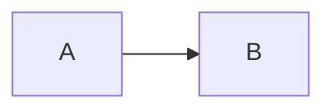

# Проверка вида

Текст с **жирным**, *курсивом*, `кодом` и [[Ссылкой]]. Значение {{ items.length }}.

- пункт списка
- [ ] задача
- [x] сделано

> [!info] Выноска
> её текст

<details open>
<summary>Свёртка</summary>

скрытый текст

</details>

| Имя | Число |
| --- | ---: |
| a   |     1 |
| b   |     2 |

```chart
type: bar
title: График
Месяц | План
Янв | 10
Фев | 14
```

```toc
```

```json name=items
[{"id":1},{"id":2}]
```

```json ref=items
```

```http name=resp
GET https://example.com/
```

```js run name=total
return items.length
```

```sql db=main name=rows
select 1
```

```md template name=text
Всего {{ items.length }}
```

<!-- qa:loop name=passes -->
```js loop
for (const it of items) await body({ it })
```

```js run name=inner
return it.id
```

<!-- /qa:loop -->

```ts playwright name=scenario
await page.goto('https://example.com')
```



```work
period: today
view: table
```

```ts
const plain = 'code'
```

---
